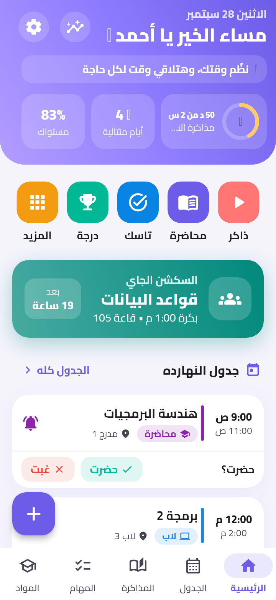
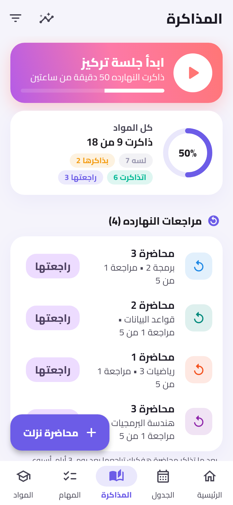
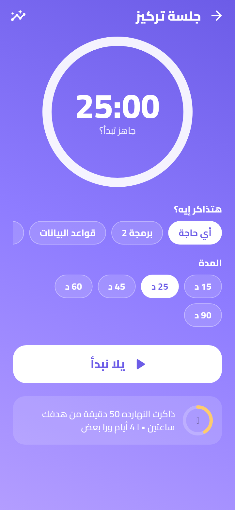
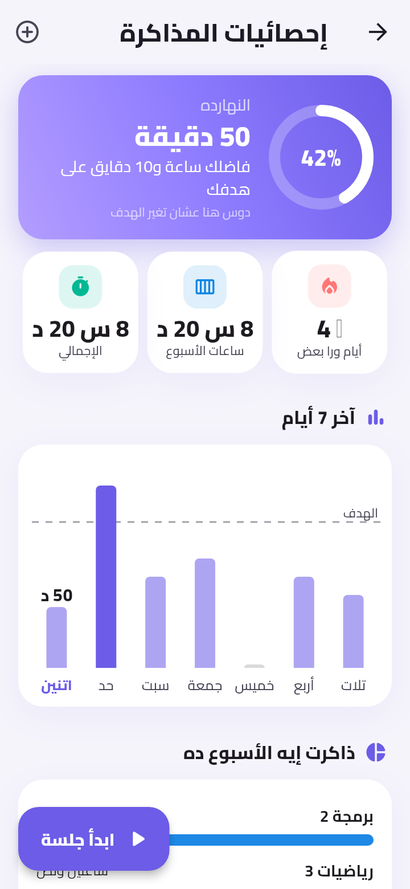
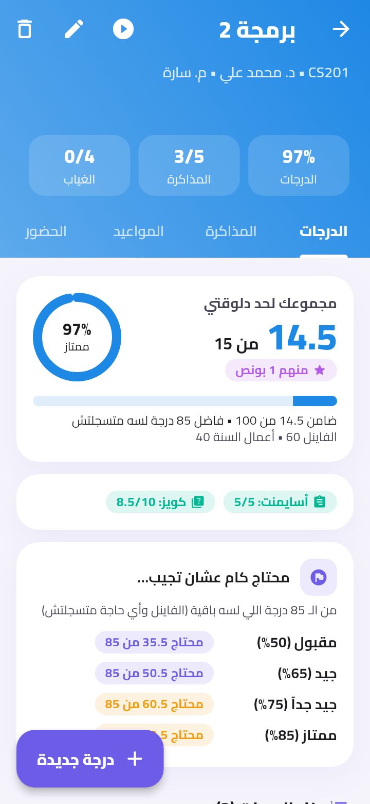
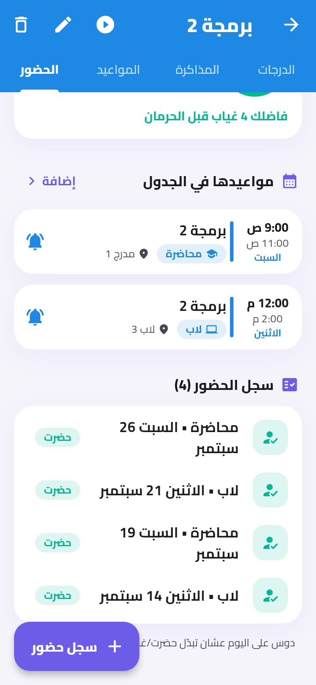
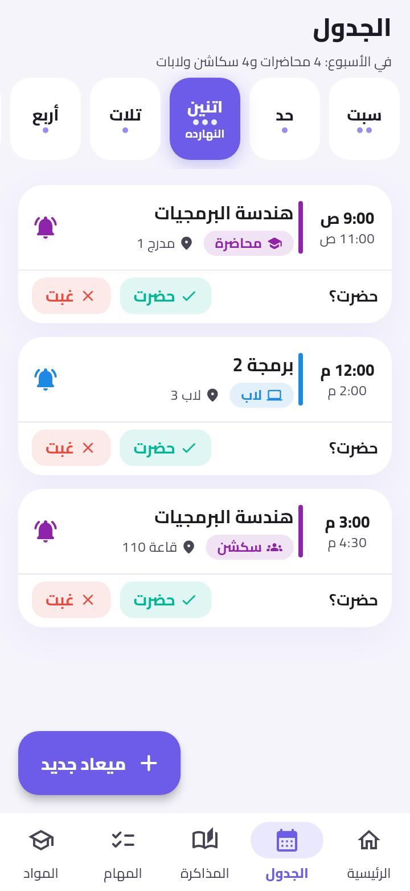
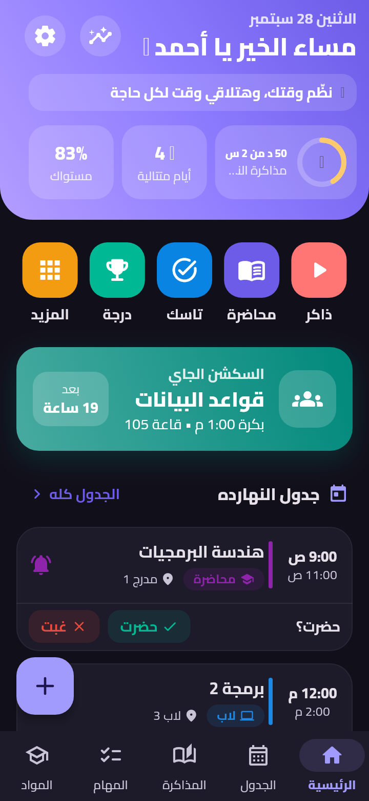

# منظم دراستي 🎓

تطبيق موبايل (Flutter) بالعربي بينظم حياتك الجامعية كلها في مكان واحد: الجدول والحضور، المحاضرات والمذاكرة والمراجعة، جلسات التركيز والإحصائيات، التاسكات، الكويزات والأسايمنتات، المشاريع، والدرجات والـ GPA — مع إشعارات بتفكرك بكل حاجة في معادها.

<p align="center">
  
  
  
  
</p>
<p align="center">
  
  
  
  
</p>

## المميزات

| القسم | بيعمل إيه |
|---|---|
| **الرئيسية** | تحية باسمك وجملة تحفيزية كل يوم، مذاكرة النهارده مقابل هدفك، أيامك المتتالية 🔥، المحاضرة الجاية وبعد قد إيه، جدول النهارده مع "حضرت؟"، مراجعات النهارده، الكويزات والتسليمات القريبة، التاسكات، وتقدمك في المذاكرة والمشاريع + زرار إضافة سريعة لأي حاجة |
| **الجدول** | جدول أسبوعي (من السبت) للمحاضرات والسكاشن واللابات، و**إشعار قبل كل ميعاد** بيتكرر كل أسبوع |
| **الحضور والغياب** | بعد كل محاضرة تعلّم حضرت/غبت، وكل مادة ليها نسبة حضور وعدد الغياب المسموح وتنبيه قبل الحرمان |
| **المذاكرة** | كل محاضرة/سكشن/شابتر بينزل تسجله: لسه / بذاكرها / اتذاكرت / راجعتها، مع نسبة لكل مادة |
| **المراجعة الذكية** | بعد ما تذاكر محاضرة التطبيق يفكرك تراجعها بعد يوم، 3 أيام، أسبوع، أسبوعين وشهر عشان تثبت |
| **جلسة تركيز (بومودورو)** | مؤقت مذاكرة لأي مادة أو محاضرة (15/25/45/60/90 دقيقة) مع بريك، وإشعار لما الجلسة تخلص حتى لو التطبيق مقفول |
| **الإحصائيات** | هدفك اليومي، وقت المذاكرة النهارده والأسبوع والإجمالي، أيام متتالية، رسم لآخر 7 أيام، وذاكرت كل مادة قد إيه |
| **المهام** | تاسكات بأهمية ومعاد وتذكير، كويزات وامتحانات، أسايمنتات، ومشاريع مقسمة لمراحل بتحسب وصلت لحد فين |
| **المواد والدرجات** | صفحة لكل مادة فيها درجاتك (خدت كام، من كام، إمتى، من إيه، والبونص)، مجموعك وتقديرك، و**محتاج كام من الباقي** عشان توصل لكل تقدير |
| **نظام التقدير** | تقديرات (ممتاز/جيد جداً/جيد/مقبول) أو **ساعات معتمدة وGPA متوقع** |
| **الإعدادات** | اسمك، هدفك اليومي، مدة الجلسة والبريك، الإشعارات وملخص الصبح، الوضع الغامق، نسخة احتياطية واسترجاع، بيانات تجريبية |

- كل البيانات محفوظة على الموبايل بس (مفيش سيرفر ولا حساب).
- لما تعلّم على كويز إنه "خلص" تقدر تسجل درجته على طول وهتتحسب في درجات المادة.
- خط **Cairo** وتصميم بألوان مبهجة ووضع غامق.

## التشغيل

محتاج [Flutter](https://docs.flutter.dev/get-started/install) (3.38 أو أحدث).

```bash
flutter pub get
flutter run            # على موبايل متوصل أو إيميوليتر
```

عشان تطلع APK تنزله على موبايلك:

```bash
flutter build apk --release --split-per-abi
# الملف هيبقى في build/app/outputs/flutter-apk/app-arm64-v8a-release.apk
```

> أول ما تفتح التطبيق هيطلب إذن الإشعارات — وافق عليه عشان يفكرك بالمحاضرات.
> لو عايز تجرب بسرعة: من الشاشة الرئيسية دوس **"جرّب ببيانات تجريبية"**.

## هيكل الكود

```
lib/
  models/        المواد، الجدول، الحضور، المحاضرات، جلسات المذاكرة، التاسكات، الكويزات، المشاريع، الدرجات، الإعدادات
  data/          AppStore (الحالة والحفظ في ملف JSON)، التخزين، البيانات التجريبية
  services/      reminder_planner (بيحسب الإشعارات المطلوبة) و notification_service (بيجدولها)
  screens/       الشاشات والفورمز
  theme/         الألوان والخط والثيم
  widgets/       عناصر مشتركة
  utils/         التنسيق بالعربي، الدرجات والـ GPA، إحصائيات المذاكرة، الجدول
assets/          خط Cairo وأيقونة التطبيق
test/            اختبارات للإشعارات والدرجات والمراجعة والمؤقت والحفظ والواجهة
```

```bash
flutter analyze
flutter test
```

### ملاحظات
- **الإشعارات على أندرويد:** التطبيق بيستخدم `USE_EXACT_ALARM` عشان التنبيه ييجي في الدقيقة بالظبط. لو هتنشره على Google Play ومش هيتقبل كتطبيق تقويم، شيل السطر ده من `AndroidManifest.xml` وشيل `maxSdkVersion` من `SCHEDULE_EXACT_ALARM`، والمستخدم يدي الإذن من الإعدادات (التطبيق فيه زرار لده).
- **الـ GPA** محسوب على سلم شائع (A من 90، B من 75، C من 60، D من 50) — الجامعات بتختلف شوية فاعتبره تقريبي.
- خط Cairo مرخص بـ SIL Open Font License (`assets/fonts/Cairo-OFL.txt`).
