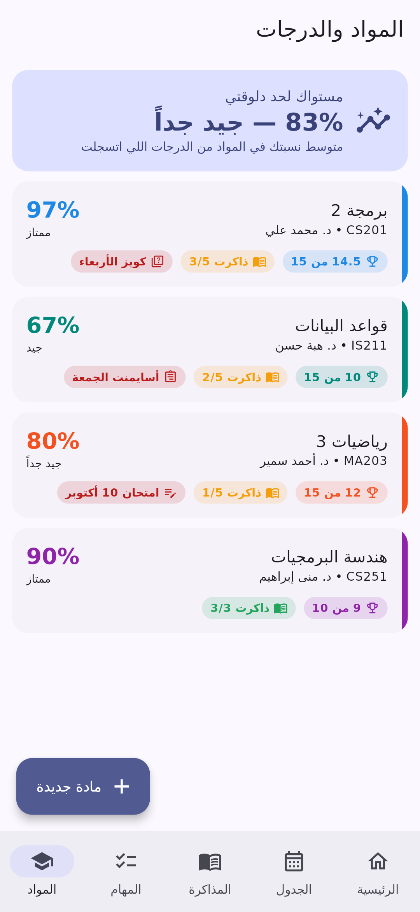
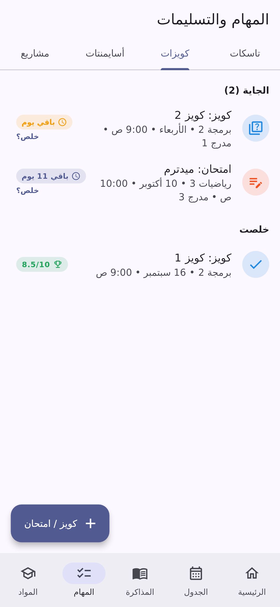
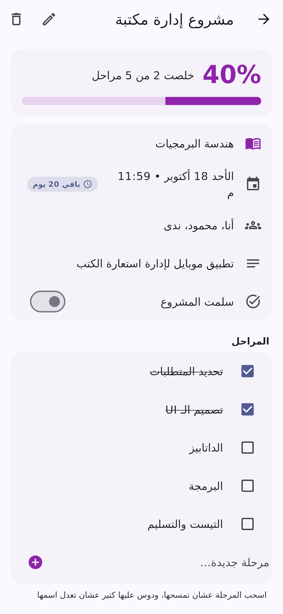

# منظم دراستي 🎓

تطبيق موبايل (Flutter) بالعربي بينظم حياتك الجامعية كلها في مكان واحد: الجدول، المحاضرات والمذاكرة، التاسكات، الكويزات والأسايمنتات، المشاريع، والدرجات — مع إشعارات بتفكرك بكل حاجة في معادها.

<p align="center">
  
  
  
  
</p>
<p align="center">
  
  
  
</p>

## المميزات

| القسم | بيعمل إيه |
|---|---|
| **الرئيسية** | المحاضرة الجاية وبعد قد إيه، جدول النهارده، الكويزات والتسليمات القريبة، التاسكات، تقدمك في المذاكرة والمشاريع |
| **الجدول** | جدول أسبوعي (من السبت) للمحاضرات والسكاشن واللابات بالمكان والدكتور، و**إشعار قبل كل ميعاد** بيتكرر كل أسبوع (في وقتها، أو قبلها بـ 5/10/15/30 دقيقة أو ساعة) |
| **المذاكرة** | كل محاضرة/سكشن/شابتر بينزل بتسجله، وتعلّم عليه: لسه / بذاكرها / اتذاكرت / راجعتها، مع نسبة اللي خلصته لكل مادة وفلتر "اللي لسه" و"اللي خلصتها" |
| **المهام** | تاسكات بأهمية ومعاد وتذكير، كويزات وامتحانات، أسايمنتات، ومشاريع مقسمة لمراحل بتحسب **وصلت لحد فين** |
| **المواد والدرجات** | صفحة لكل مادة فيها كل درجاتك: خدت كام، من كام، إمتى، من إيه (كويز، ميدترم، أسايمنت، عملي، شفوي، حضور، فاينل…) و**البونص**. بيحسبلك مجموعك ونسبتك وتقديرك، و**محتاج كام من الباقي عشان تجيب مقبول/جيد/جيد جداً/ممتاز** |
| **الإشعارات** | تنبيه قبل المحاضرات، قبل الكويزات والتسليمات والمشاريع والتاسكات (يوم / ساعة / … تختار)، وملخص اليوم الصبح |
| **الإعدادات** | اسمك، الوضع الغامق، نسخة احتياطية واسترجاع، بيانات تجريبية للتجربة |

- كل البيانات محفوظة على الموبايل بس (مفيش سيرفر ولا حساب).
- لما تعلّم على كويز إنه "خلص" تقدر تسجل درجته على طول وهتتحسب في درجات المادة.
- التقدير محسوب على النظام المصري: ممتاز 85%، جيد جداً 75%، جيد 65%، مقبول 50%.

## التشغيل

محتاج [Flutter](https://docs.flutter.dev/get-started/install) (3.38 أو أحدث).

```bash
flutter pub get
flutter run            # على موبايل متوصل أو إيميوليتر
```

عشان تطلع APK تنزله على موبايلك:

```bash
flutter build apk --release
# الملف هيبقى في build/app/outputs/flutter-apk/app-release.apk
```

> أول ما تفتح التطبيق هيطلب إذن الإشعارات — وافق عليه عشان يفكرك بالمحاضرات.
> لو عايز تجرب بسرعة: من الشاشة الرئيسية دوس **"جرّب ببيانات تجريبية"**.

## هيكل الكود

```
lib/
  models/        المواد، الجدول، المحاضرات، التاسكات، الكويزات، المشاريع، الدرجات، الإعدادات
  data/          AppStore (الحالة والحفظ في ملف JSON)، التخزين، البيانات التجريبية
  services/      reminder_planner (بيحسب الإشعارات المطلوبة) و notification_service (بيجدولها)
  screens/       الشاشات والفورمز
  widgets/       عناصر مشتركة
  utils/         التنسيق بالعربي، حساب الدرجات، الجدول
test/            اختبارات للإشعارات والدرجات والحفظ والواجهة
```

```bash
flutter analyze
flutter test
```

### ملاحظة عن الإشعارات على أندرويد
التطبيق بيستخدم `USE_EXACT_ALARM` عشان التنبيه ييجي في الدقيقة بالظبط. لو هتنشره على Google Play ومش هيتقبل كتطبيق تقويم، شيل السطر ده من `AndroidManifest.xml` وشيل `maxSdkVersion` من `SCHEDULE_EXACT_ALARM`، والمستخدم يدي الإذن من الإعدادات (التطبيق فيه زرار لده).
